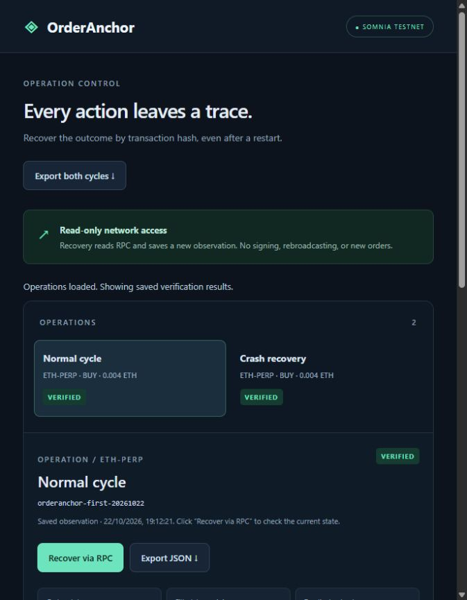

# OrderAnchor

[GitHub repository](https://github.com/Seranov67/OrderAnchor) · [Offline checks](https://github.com/Seranov67/OrderAnchor/actions/workflows/checks.yml)

Recover the outcome of a dreamDEX Perps operation after a lost RPC response or process restart, without placing the same order again.

OrderAnchor is a local prototype for developers who need to answer: **Did my transaction land, what happened to the order, and is it safe to continue?**

## Run the local demo

Requires Node.js **22.17.1**. SDK **0.32.1** and viem **2.54.1** are pinned in the lockfile.

```powershell
npm.cmd ci --ignore-scripts --no-audit --no-fund
npm.cmd run ui
```

Open **http://127.0.0.1:4317**. Inspect both completed testnet cycles, their transaction hashes and journals. **Recover via RPC** checks current network facts. **Export JSON** downloads portable public evidence. No wallet connection or private key is required to verify public evidence.

The original private SQLite journals are accessible only to their owning Windows profile. When unavailable, the UI explicitly shows public evidence instead. All saved observations display their timestamp.

## Demonstrated on testnet

| Scenario | Result |
|---|---|
| Normal POST_ONLY place → cancel | Confirmed, cancelled, zero fills and position |
| Accepted place → hidden response → forced termination → restart | Same persisted hash recovered from UNKNOWN; no second place; remaining order cancelled |
| Independent verification | All four hashes reconstructed, signatures checked, canonical receipts matched, both orders cancelled |
| Safe next-operation release | Implemented and tested; fresh completion checks before release, preparation and broadcast |

The fault was injected locally after RPC acceptance. This demonstrates one recovery path, not a universal exactly-once guarantee or a real provider outage. Assets were testnet paper USDso and STT on chain **50383**.

## Independently verify evidence

```powershell
npm.cmd run evidence -- verify evidence/testnet-cycles-export-v1.json evidence/new-verification.json
```

Use a new output filename. Verification only reads RPC. It checks exact calldata, recovered signer, nonce, canonical receipts, order events, remaining state and historical nonce bounds. Network failures remain incomplete rather than VERIFIED.

Exports exclude private keys, signatures and broadcastable transaction bytes. SHA-256 detects changes, not author authenticity. RPC is the trust source, not a consensus light client. Process termination and send-attempt counts are local evidence; the chain proves mined identities and nonce intervals.

## Architecture and safe continuation

`Local UI / CLI → SQLite journal → testnet adapter → reconciliation → independent verifier → public evidence`

Signed bytes and the local hash are committed before broadcast. UNKNOWN is persisted before transport; response loss does not trigger a hidden retry. Recovery reads the original hash. Cancellation and order lifecycle are tracked separately.

The signer slot is released only after a fresh zero-fill cancellation proof, empty account exposure and expected nonce. Checks repeat before the next prepare/send; detected reorgs halt the signer. Release is scoped to one canonical database and dedicated signer, not unrelated files or external bots.

The UI exposes no signing, placement, cancellation, rebroadcast or unlock endpoint. Live test harnesses require separate explicit authorization. Mainnet and portable private-state backups are outside this MVP.

## Validation

```powershell
npm.cmd run typecheck
npm.cmd test
npm.cmd run cli -- help
```

The suite covers durable commits, restart recovery, cancellation, partial fills, evidence tampering, unavailable RPC, release guards, reorg halts and local API protections. The pinned Node version marks node:sqlite experimental.

## Reviewer materials



- [English demo and evidence guide](docs/DEMO.md)
- [Public evidence for both cycles](evidence/testnet-cycles-export-v1.json)
- [Independent verification results](evidence/testnet-cycles-verification-2026-10-22.json)
- [Crash/restart evidence](evidence/crash-cycle-2026-10-22.json)
- [Safe-release dry-run](evidence/completion-check-2026-10-22.json)
- [Third-party notices](THIRD_PARTY_NOTICES.md)

All submission documentation is available in English. Start with [the submission overview](docs/SUBMISSION.md), [clean startup instructions](RUN.md) and the demo guide. Historical checkpoints retain their dates and evidence boundaries. The submission package excludes secrets, private SQLite files, runtime data, temporary sources and installed dependencies.

## Repository preparation

The public repository is [https://github.com/Seranov67/OrderAnchor](https://github.com/Seranov67/OrderAnchor). Its initial commit publishes the 87 files from the verified v3 submission archive; subsequent documentation updates add public links and refresh the manifest. See [publication preparation](docs/GITHUB-PREPARATION.md) for provenance and validation. Contest submission and X posts remain pending.

## X posts

Publication is pending. Before contest submission, add links to 2–3 posts about OrderAnchor tagging `@DreamDEXSomnia`. No published links have been supplied or verified yet. See the [unpublished submission and post drafts](docs/SUBMISSION-FORM-DRAFT.md) and [dated contest readiness checklist](docs/CONTEST-READINESS-2026-10-22.md).
