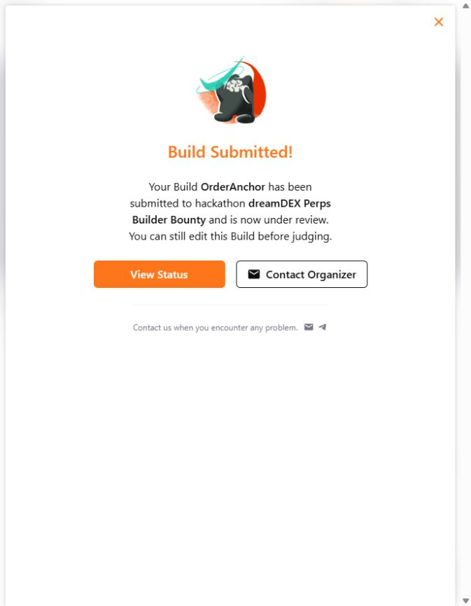

# OrderAnchor — contest submission record

- **Status:** Submitted / Under Review.
- **Event:** dreamDEX Perps Builder Bounty.
- **Track:** MVP (trader tool).
- **Submitted and verified:** 22 October 2026; recorded verification at 18:34:31 UTC.
- **DoraHacks Build:** [https://dorahacks.io/build/50160](https://dorahacks.io/build/50160).
- **Event submission status:** [https://dorahacks.io/hackathon/dreamdex-perps-bounty/build](https://dorahacks.io/hackathon/dreamdex-perps-bounty/build) (authenticated entrant view; the organizer keeps the submission list private).

DoraHacks displayed **Build Submitted!**, changed Submit Build to Manage Submission, and showed **Your Build / Under Review / TRACK MVP** after page reload. This establishes successful receipt and submission access for this entrant. No separate whitelist roster was accessed. Judging remains pending; no award or approval decision is claimed.

The entrant explicitly authorized final terms and Submit for Review. Required organizer contact answers were completed privately. No private contact answers, registration/reward wallet settings, form snapshots, keys or private databases are distributed in this package. No new blockchain transactions or messages to organizers were sent to submit the project.

[Public status record](../evidence/dorahacks-submission-status-2026-10-22.json) · [Submission confirmation](../evidence/dorahacks-submission-confirmation-2026-10-22.png) · [English demo v2](../media/demo-v2/README.md) · [X posts](../README.md#x-posts)

## Public Build description as saved on DoraHacks

An RPC timeout can happen after a transaction has been accepted. A bot that treats the timeout as failure can place a second order. OrderAnchor preserves transaction identity before broadcast and helps developers determine what happened before continuing.

The TypeScript/Node.js prototype commits the signed transaction and locally calculated hash to a durable SQLite journal before sending. It records uncertainty before transport. After restart, reconciliation reads the original hash rather than issuing another placement. Placement, cancellation and order lifecycle are tracked separately.

The English local interface supports operation inspection, read-only RPC recovery and public JSON export. An independent verifier reconstructs transaction hashes and signers, checks exact payloads and canonical receipts, reads order history and current order state, and verifies scoped signer nonce intervals. Indexed order-ID queries cover both maker and taker fills across the complete verification block range, avoiding oversized pool-wide history responses. Public exports exclude private keys, signatures and broadcastable signed transaction bytes.

Two real ETH-PERP POST_ONLY place/cancel cycles were demonstrated on Somnia Tokyo testnet, chain 50383. In the second cycle, a local wrapper hid an accepted RPC response and terminated the executor process. A restarted process recovered the original hash without another placement and then cancelled the remaining order. Both recorded cycles ended with zero fills and no position. Fresh read-only CLI checks verified both cycles, and the UI freshly confirmed the crash cycle as VERIFIED / CANCELLED with zero filled and remaining quantity. The English demo v2 shows these results and actual JSON export.

Conservative continuation guards require fresh completion evidence, zero exposure and the expected nonce before another operation can proceed. The project has 63 passing tests and successful GitHub Actions checks. Its repeat-use workflow is inspect, recover, verify and export for each uncertain operation.

Response loss was injected locally in the recorded experiment. This is not a universal exactly-once guarantee or a mainnet service. RPC is trusted for chain facts; duplicate-place checks cover the documented signer and place-to-cancel block intervals. Continuation assumes one canonical journal and a dedicated signer. Somnia Reactivity and Somnia Agents are not used in this version.

## Review materials

- [GitHub repository](https://github.com/Seranov67/OrderAnchor)
- [English demo v2: MP4, subtitles and transcript](https://github.com/Seranov67/OrderAnchor/tree/main/media/demo-v2)
- [Fresh independent verification of both cycles](https://github.com/Seranov67/OrderAnchor/blob/main/evidence/rpc-history-verification-2026-10-22-v2.json)
- [Fresh UI crash-cycle recovery](https://github.com/Seranov67/OrderAnchor/blob/main/evidence/rpc-history-ui-recovery-2026-10-22-v2.json)
- [Public evidence bundle](https://github.com/Seranov67/OrderAnchor/blob/main/evidence/demo-v2-cycles-export.json)

## X posts

All posts tag @DreamDEXSomnia.

1. [Project introduction](https://x.com/donnydan3/status/2113332274603368682)
2. [Demo v2](https://x.com/donnydan3/status/2113332347135201321)
3. [Public testnet evidence](https://x.com/donnydan3/status/2113332451095261410)

## Run locally

Use Node.js 22.17.1, run `npm ci --ignore-scripts --no-audit --no-fund` and `npm run ui`, then open http://127.0.0.1:4317. No wallet, private key or private database is needed to inspect the included public evidence.
