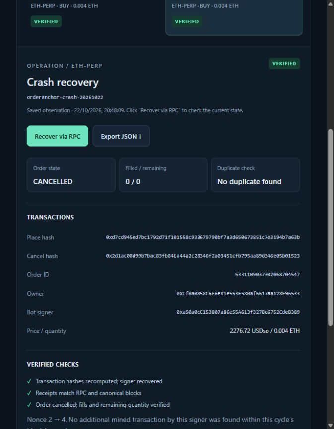

# OrderAnchor demo v2

[Watch or download the MP4](OrderAnchor-demo-en-v2.mp4) · [English subtitles](OrderAnchor-demo-en.srt) · [Transcript](TRANSCRIPT.md) · [Video integrity and QA](DEMO-CHECKS.json)

Duration: 97.724 seconds. Full HD 1920×1080, H.264 / AAC, 30 fps. English synthetic Windows Zira narration, burned-in and selectable English subtitles.

This edited walkthrough uses genuine local application captures: inspect the recorded cycles, follow the persisted UNKNOWN-to-CONFIRMED journal, request fresh read-only RPC verification, inspect VERIFIED / CANCELLED / 0 filled / 0 remaining, and export public JSON. Held frames and cuts shorten waiting time; it is not continuous real-time screen recording.

The original place, injected response loss, restart and cancel belong to the previously recorded testnet experiment. No new orders, cancellations, signing or broadcast occurred during recording or this publication. The demo was recorded before the contest submission. OrderAnchor was subsequently [submitted to DoraHacks](https://dorahacks.io/build/50160) on 22 October 2026 and is **Under Review**.

## Fresh public evidence

- [Both cycles verified independently](../../evidence/rpc-history-verification-2026-10-22-v2.json)
- [Fresh UI crash-cycle observation](../../evidence/rpc-history-ui-recovery-2026-10-22-v2.json)
- [Downloaded two-cycle bundle](../../evidence/demo-v2-cycles-export.json)
- [Downloaded crash-cycle bundle](../../evidence/demo-v2-crash-export.json)
- [63 passing regression tests](../../evidence/rpc-history-tests-2026-10-22.tap)
- [Root cause and fix](../../docs/rpc-history-fix-2026-10-22.md)

The UI observation is timestamped 2026-10-22T17:48:09.112Z. Saved verification proves what was checked at that time; use the application's read-only RPC verification for another observation. RPC is the trust source, not a consensus light client. Duplicate-place checks cover this signer only within each documented place-to-cancel block interval. SHA-256 establishes file integrity, not author identity. Private keys, private databases, signatures and broadcastable signed transaction bytes are not distributed.
